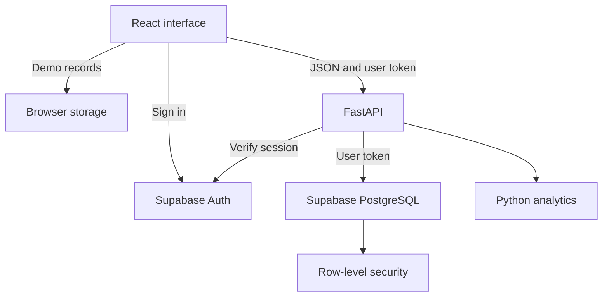

<div align="center">


# Launchpad

**A workspace for your next career move.**

Track opportunities, prepare for interviews, and see your progress in one place.

[Features](#features) · [Getting started](#getting-started) · [Architecture](#architecture) · [API](#api) · [Testing](#testing)
</div>

---

Job applications can quickly become a collection of browser tabs, emails, and spreadsheets. Launchpad brings those details together in a focused dashboard so you can see where each opportunity stands and what needs attention next.

## Features

- **Application tracking:** Save opportunities with company, role, location, application date, listing link, and notes. Edit or delete them as your plans change.
- **Pipeline views:** Organize applications across Saved, Applied, Interview, Offer, and Closed stages. Switch between a searchable table and a board.
- **Interview preparation:** View upcoming interviews and keep preparation notes alongside each role.
- **Follow-up dates:** See applications with follow-ups due or overdue directly on the dashboard.
- **Insights:** Explore stage totals, six weeks of application activity, and current pipeline progression.
- **CSV export:** Download application records with support for quoted text and spreadsheet formula protection.
- **Demo mode:** Explore fictional sample data without an account. Demo changes are stored locally in the browser.
- **Personal accounts:** With Supabase configured, users can sign up and access their own saved applications across devices.

Follow-ups are shown in the app; automated notifications are not currently available. Pipeline stages are updated through a dropdown.

## Technology

| Layer | Technologies |
| --- | --- |
| Frontend | React, TypeScript, Vite, CSS, Lucide icons |
| Backend | Python 3.12, FastAPI, Pydantic, HTTPX |
| Authentication and storage | Supabase Auth, PostgreSQL, row-level security |
| Deployment | Vercel static hosting and Python Functions |
| Testing | Pytest, Vitest, GitHub Actions |

## Getting started

### Requirements

- Node.js 22 or newer and npm
- Python 3.12
- A terminal opened in the project directory containing `package.json`

Supabase is optional for demo mode.

### Windows PowerShell

```powershell
py -3.12 -m venv .venv
.\.venv\Scripts\python.exe -m pip install -r requirements-dev.txt
npm.cmd ci
npm.cmd run dev:full
```

If `python --version` reports Python 3.12, `python -m venv .venv` also works. `npm.cmd` avoids PowerShell execution policy errors for `npm.ps1`.

### macOS / Linux

```bash
python3.12 -m venv .venv
.venv/bin/python -m pip install -r requirements-dev.txt
npm ci
npm run dev:full
```

Open the local URL printed by Vite, normally `http://localhost:5173`. The command starts both the frontend and backend. Stop them with `Ctrl+C`.

- API health: `http://localhost:8000/api/health`
- Interactive API documentation: `http://localhost:8000/api/docs`

### Demo and personal workspaces

Demo mode starts with fictional applications. Changes are saved in the current browser and can be reset from the dashboard. A signed-in workspace stores application data in Supabase and starts empty; demo data is not automatically imported into it.

To enable accounts, configure a Supabase project, execute [`supabase/schema.sql`](supabase/schema.sql), and provide the frontend and backend environment variables shown in [`.env.example`](.env.example). Use the project's publishable or legacy anon key, never a secret or service-role key. The complete setup and deployment instructions are in [docs/DEPLOYMENT.md](docs/DEPLOYMENT.md).

## Architecture



The frontend sends authenticated requests to the Python API. FastAPI validates inputs, verifies the user with Supabase Auth, and forwards the user token to the database. PostgreSQL row-level security restricts access to each user's records. Analytics are calculated by the API from the current application data.

| Directory | Purpose |
| --- | --- |
| `src/` | React interface, data model, API client, and styles |
| `api/` | FastAPI endpoints and analytics |
| `supabase/` | Database schema and access policies |
| `tests/` | Python API tests |
| `docs/` | Engineering, deployment, and validation documentation |

## API

| Method | Endpoint | Access | Description |
| --- | --- | --- | --- |
| GET | `/api/health` | Public | Service health and version |
| POST | `/api/analytics` | Public | Calculate metrics for submitted records |
| GET | `/api/applications` | Authenticated | List the current user's applications |
| POST | `/api/applications` | Authenticated | Create an application |
| PUT | `/api/applications/{id}` | Authenticated | Update an owned application |
| DELETE | `/api/applications/{id}` | Authenticated | Delete an owned application |
| GET | `/api/docs` | Public | Interactive API documentation |

## Understanding the metrics

- **In progress** counts applications currently marked Applied or Interview.
- **Current progression** is `(Interview + Offer) / all non-Saved applications × 100`. Closed applications remain in the denominator. It describes the current pipeline, not a historical conversion rate.
- **Application activity** counts explicit application dates in the last six Monday-start weeks; undated entries are excluded.
- **Follow-ups due** counts follow-up dates up to today, excluding Offer and Closed records.

The browser and server use their respective local calendar dates, which can differ around midnight. Analytics accept up to 500 records; this is not an enforced database quota.

## Testing

```bash
npm test
npm run build
```

Run Python tests with the project virtual environment:

```powershell
# Windows
.\.venv\Scripts\python.exe -m pytest -q
```

```bash
# macOS / Linux
.venv/bin/python -m pytest -q
```

The tests cover analytics, input validation, API authentication boundaries, record ownership filters, search, and CSV export. Supabase responses are mocked in the API tests; live account and database-policy checks require a configured Supabase project. See [docs/VALIDATION.md](docs/VALIDATION.md) for verification details.

## Deployment

The repository includes configuration for Vercel, with a Vite frontend and a Python API. A deployment can run in demo mode without Supabase, or use a configured Supabase project for account storage. See [docs/DEPLOYMENT.md](docs/DEPLOYMENT.md) for setup and release checks.

## License

MIT. See [LICENSE](LICENSE). Third-party packages, icons, and fonts retain their respective licenses.
