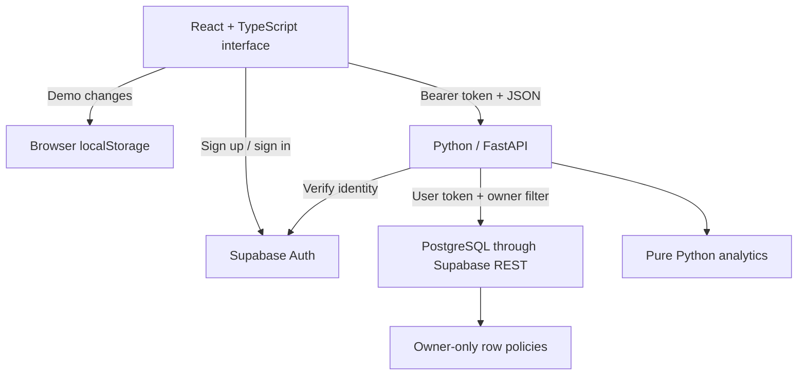

<div align="center">


# Launchpad

### Your next chapter, organized.

An internship application workspace built with **Python, FastAPI, React, TypeScript, and PostgreSQL**.

Track opportunities. Prepare for interviews. Understand your progress.

[Quick start](#quick-start) · [Features](#features) · [Architecture](#architecture) · [Deploy to Vercel](#deploy-to-vercel) · [Engineering walkthrough](docs/ENGINEERING.md)

</div>

---

## Why this exists

An internship search quickly becomes a mix of bookmarks, spreadsheets, email threads, and forgotten follow-ups. Launchpad brings the details into one focused workspace: where you applied, what happens next, and what your activity looks like over time.

The project is intentionally scoped as a complete, understandable undergraduate fullstack application. Python handles a validated REST API and analytics, React provides the interactive experience, and PostgreSQL owns durable account data. The UI includes a clearly labeled demo so someone reviewing the project can explore it without signing up.

**Status:** implemented portfolio release. Local automated checks and browser review are documented in [VALIDATION.md](docs/VALIDATION.md). Deployment configuration is included; this repository does not claim a live Vercel deployment or verified production Supabase integration. Add your deployed URL to the GitHub repository's **About → Website** field after completing the deployment smoke test.

## Features

| Area                  | What you can do                                                                                   |
| --------------------- | ------------------------------------------------------------------------------------------------- |
| Dashboard             | View application counts, active opportunities, interviews, offers, and six weeks of activity      |
| Application workspace | Create, edit, and delete applications with company, role, location, dates, listing URL, and notes |
| Pipeline              | Switch between a table and a board; update stages through keyboard-accessible dropdowns           |
| Search                | Combine case-insensitive company/role/location search with a stage filter                         |
| Interviews            | See upcoming dated interviews and prepare talking points                                          |
| Follow-ups            | Surface applications whose follow-up date is today or overdue                                     |
| Insights              | Inspect the stage distribution and a precisely defined current progression percentage             |
| Export                | Download the complete workspace as CSV with quoting and formula-prefix protection                 |
| Demo mode             | Explore fictional sample applications; changes persist only in your browser                       |
| Personal accounts     | Register, confirm email, sign in, and sign out using Supabase Auth after setup                    |
| Data isolation        | Verified user identity in FastAPI and owner-only PostgreSQL row-level security                    |
| Quality               | Typed frontend, validated API inputs, tests, CI, explicit error/empty/loading states              |

There are no paid AI APIs, background workers, or always-on servers required. Follow-up dates are in-app reminders, **not automatic email notifications**. Board updates use a select control, not drag-and-drop.

## Tech stack

| Layer       | Technology                                 | Reason                                                                   |
| ----------- | ------------------------------------------ | ------------------------------------------------------------------------ |
| Interface   | React + TypeScript                         | Reusable components and explicit application types                       |
| Tooling     | Vite                                       | Fast local development and a small static production build               |
| Styling     | Plain CSS, Lucide icons, DM Sans / Manrope | A cohesive responsive design without a UI-framework dependency           |
| Backend     | Python 3.12 + FastAPI + Pydantic           | Typed request validation, API documentation, and testable business logic |
| Data access | HTTPX + Supabase REST API                  | Stateless HTTP connections that suit serverless execution                |
| Database    | Supabase PostgreSQL                        | Durable storage, constraints, indexes, and row-level security            |
| Identity    | Supabase Auth                              | Email/password sessions without implementing password storage            |
| Hosting     | Vercel static assets + Python Functions    | One origin for the UI and `/api/*`                                       |
| Testing     | Pytest + Vitest + GitHub Actions           | Repeatable behavior checks for both languages                            |

Exact frontend versions are locked in `package-lock.json`. Python's direct dependencies are pinned in `requirements.txt`; transitive versions are resolved at install time.

## Quick start

**Prerequisites:** Node.js 22 or newer, Python 3.12, npm, and Git. No database account is needed for demo mode.

Download/extract the project or clone your copy of the repository, then open a terminal **inside the folder containing `package.json`**.

### Windows PowerShell

```powershell
py -3.12 -m venv .venv
.\.venv\Scripts\python.exe -m pip install -r requirements-dev.txt
npm ci
npm run dev:full
```

### macOS / Linux

```bash
python3.12 -m venv .venv
.venv/bin/python -m pip install -r requirements-dev.txt
npm ci
npm run dev:full
```

Open the local URL Vite prints (normally `http://localhost:5173`). `npm run dev:full` starts the Vite frontend and Python API together. The script automatically uses the project `.venv`; if needed, set the `PYTHON` environment variable to a different interpreter's absolute path.

- Frontend: `http://localhost:5173`
- Backend health: `http://localhost:8000/api/health`
- Interactive API documentation: `http://localhost:8000/api/docs`
- Stop both services: `Ctrl+C`

`npm run dev` runs the frontend only; use it when running the API separately with `python -m uvicorn api.index:app --reload --port 8000`.

The development proxy forwards `/api` to port 8000. Opening only the Vite production preview will **not** start Python; analytics require the API or a Vercel deployment.

### A two-minute demo

1. Open **Overview** and inspect the sample pipeline.
2. Select **Add application**, enter a company and role, and save.
3. Open **Applications → Board view** and move it to **Applied** using its stage dropdown.
4. Edit the application, set **Interview**, add an upcoming interview date and preparation notes.
5. Open **Interviews** to see the preparation card.
6. Search/filter your applications, export the CSV, and reload to confirm local persistence.
7. **Reset** restores the fictional examples after confirmation.

## Demo mode vs personal accounts

| Behavior                       | Demo                                    | Signed-in account                   |
| ------------------------------ | --------------------------------------- | ----------------------------------- |
| Application storage            | This browser's `localStorage`           | Supabase PostgreSQL                 |
| Sample data                    | Nine fictional applications             | Starts empty                        |
| Analytics                      | Python API receives the current records | Same Python calculation             |
| CRUD                           | Browser-local state                     | Authenticated Python REST endpoints |
| Accessible from another device | No                                      | Yes                                 |
| Reset demo                     | Replaces local examples                 | Does not affect account records     |

Demo data is not automatically imported when you sign in. It remains in the browser and reappears after sign-out. The unauthenticated analytics endpoint processes submitted data in memory; it does not save it. Hosting infrastructure can still log request metadata. Avoid storing sensitive personal notes in a public demo on a shared computer.

## Enable accounts and persistent storage

1. Create a Supabase project.
2. In its SQL Editor, run [`supabase/schema.sql`](supabase/schema.sql) **once**. It creates the table, an owner index, constraints, grants, and four row-level security policies. Re-running without resetting the schema will report that objects already exist.
3. Enable email/password authentication. Keep email confirmation enabled.
4. Set the Auth Site URL to your app's origin. Add your local development origin and intended deployment origin to the allowed redirect URLs.
5. Copy `.env.example` to `.env.local`, then fill in all four values:

```dotenv
VITE_SUPABASE_URL=https://YOUR_PROJECT.supabase.co
VITE_SUPABASE_PUBLISHABLE_KEY=YOUR_PUBLISHABLE_KEY
SUPABASE_URL=https://YOUR_PROJECT.supabase.co
SUPABASE_PUBLISHABLE_KEY=YOUR_PUBLISHABLE_KEY
```

Use the **publishable key**, or the project's legacy `anon` key if applicable. **Never use a secret/service-role key.** Both frontend and backend must point to the same project. Values beginning with `VITE_` are compiled into the browser bundle and must not contain secrets.

6. Restart `npm run dev:full`.
7. Create an account, confirm the email, and sign in. Add an application and verify it survives sign-out and sign-in.
8. Create a second test account and confirm it cannot read, edit, or delete the first account's applications. Follow [the release checklist](docs/DEPLOYMENT.md#release-smoke-test) before advertising cloud accounts publicly.

Supabase provides signup emails subject to its configured email service and rate limits. Configure an appropriate SMTP provider in Supabase if opening registration to general public use. Password reset, social login, account deletion UI, and email reminders are outside this release's scope.

## Architecture



**A save request:** React sends the form to `POST /api/applications`. Pydantic validates it; the identity dependency verifies the access token with Supabase. Python injects the authenticated owner ID and forwards the same user token to the database. PostgreSQL independently enforces ownership. The returned row updates React state, which triggers a fresh analytics calculation.

**Why no SQLite on Vercel?** Function-local files are not a shared durable database. All persistent account data lives in external PostgreSQL, so this API can be recreated for each request.

### Project map

| Path                       | Responsibility                                                     |
| -------------------------- | ------------------------------------------------------------------ |
| `src/main.tsx`             | React entrypoint                                                   |
| `src/App.tsx`              | Workspace state, navigation, dashboard, list and board             |
| `src/components/`          | Application editor, authentication dialog, reusable native dialog  |
| `src/model.ts`             | Types, demo seed, search, date formatting, CSV export              |
| `src/api.ts`               | Fetch boundary and Supabase client                                 |
| `src/styles.css`           | Design system, component styles, responsive layouts                |
| `api/index.py`             | FastAPI routes, input models, analytics, auth and storage boundary |
| `supabase/schema.sql`      | Database schema, constraints and access policies                   |
| `tests/test_api.py`        | Backend unit and HTTP-boundary tests                               |
| `src/model.test.ts`        | Search, payload projection, CSV safety tests                       |
| `scripts/dev.mjs`          | Starts and stops both development services                         |
| `.github/workflows/ci.yml` | Frontend tests/build and Python tests                              |
| `vercel.json`              | Frontend build, Python route rewrite and response headers          |
| `docs/`                    | Deployment, engineering guide and verification record              |

### API reference

| Method | Endpoint                 | Authentication | Result                                            |
| ------ | ------------------------ | -------------- | ------------------------------------------------- |
| GET    | `/api/health`            | Public         | Health/version JSON                               |
| POST   | `/api/analytics`         | Public         | Metrics for up to 500 submitted records           |
| GET    | `/api/applications`      | Bearer token   | Current user's applications                       |
| POST   | `/api/applications`      | Bearer token   | Created application, HTTP 201                     |
| PUT    | `/api/applications/{id}` | Bearer token   | Replaces editable fields of the owned application |
| DELETE | `/api/applications/{id}` | Bearer token   | HTTP 204, or 404 if not visible                   |
| GET    | `/api/docs`              | Public         | Swagger UI                                        |

PUT requires the complete editable form. The frontend always sends all editable fields. The database creation timestamp and owner ID cannot be changed through this API. An unknown or inaccessible record is treated as not found. Validation returns 422; missing/invalid authentication returns 401; storage configuration errors return 503; upstream failures return a generic 502.

### Metric definitions

- **Total:** all records.
- **In progress:** Applied + Interview.
- **Interviews / offers:** records currently in those stages.
- **Current progression percentage:** `(Interview + Offer) / all non-Saved records × 100`, rounded; zero for an empty denominator. Closed applications remain in the denominator.
- **Activity:** explicit `applied_on` dates in six Monday-start weeks. Records without a date do not count. Saving a role does not automatically invent an application date.
- **Follow-ups due:** date on or before today, excluding Offer and Closed.

These are current-state summaries, **not** historical conversion, response, or success rates. Python uses its server date (UTC on Vercel); the UI uses the browser's local calendar date. Around midnight they may differ by one day. See the engineering guide for the tradeoff and a timezone-aware extension.

## Deploy to Vercel

The repository is configured for **one Vercel project**: Vite emits static assets, while `api/index.py` exposes FastAPI as a Python Function.

1. Upload the project contents to a GitHub repository. Keep `.env.local`, `.venv`, `node_modules`, and `dist` out of Git.
2. In Vercel, choose **Add New → Project → Import** your repository.
3. Select the folder containing `package.json` as the Root Directory. Use **Vite**, build command `npm run build`, output `dist`, and install command `npm ci`.
4. Keep `requirements.txt`, `.python-version`, `api/index.py`, and `vercel.json` in that same root. The `/api/:path*` rewrite routes API requests to the Python entrypoint.
5. For a zero-configuration public demo, deploy with all Supabase variables absent. For cloud accounts, add all four variables from `.env.example` to the appropriate Preview/Production environments.
6. Deploy. Open `/api/health` and verify JSON. Open the dashboard and verify the metrics load.
7. If enabling accounts, update Supabase Auth URLs to the exact Vercel origin, complete the two-account data-isolation smoke test, and test sign-out.
8. Put the real deployment URL in the GitHub About section and your resume.

Frontend environment variables are build-time settings: **redeploy** after changing them. See [DEPLOYMENT.md](docs/DEPLOYMENT.md) for Git commands, troubleshooting and the complete launch checklist.

Configuration follows the official [Vercel Python runtime](https://vercel.com/docs/functions/runtimes/python), [Vercel rewrites](https://vercel.com/docs/rewrites), [Supabase API key](https://supabase.com/docs/guides/api/api-keys), and [row-level security](https://supabase.com/docs/guides/database/postgres/row-level-security) documentation. Platform behavior and plan limits can change; verify the linked documentation if Vercel reports a build/configuration error.

## Tests and quality checks

```bash
npm test
npm run build
# macOS / Linux:
.venv/bin/python -m pytest -q
# Windows:
.\.venv\Scripts\python.exe -m pytest -q
```

`npm run build` includes TypeScript checking. GitHub Actions runs frontend tests/build and Python tests on pushes and pull requests. `npm run format` formats frontend source and documentation with Prettier.

Backend tests cover empty analytics, weekly boundaries, stage calculations, follow-up exclusions, invalid payloads, oversized bodies, authentication requirements, owner injection, owner-scoped writes, deletion, and sanitized upstream errors. Frontend tests cover combined search/filtering, API payload projection, CSV quoting and formula neutralization.

The HTTP-boundary tests use mocked Supabase responses. They **do not prove** live database policies are installed correctly; the documented two-account smoke test is still required.

## Security and limitations

- React renders user text normally; no HTML injection APIs are used.
- Only `http`/`https` job URLs are accepted. The backend never fetches arbitrary job URLs.
- The server does not trust an owner ID sent by a client. Unknown input fields are rejected.
- User access tokens are forwarded to Postgres so RLS still applies; no elevated database key is used.
- API responses are not cached. External errors are sanitized.
- JSON request bodies are capped at 1 MB; analytics arrays at 500 records. The UI limits new records at 500. This is a portfolio workload limit, **not an enforced per-user database quota**; direct API/database clients can bypass the UI limit.
- The anonymous analytics endpoint has no persistent storage or external API charge, but still consumes compute. Configure platform rate limits before promoting a high-traffic deployment.
- Supabase sessions use its browser SDK persistence. Treat XSS prevention and dependency updates seriously. This is not an independently audited system.
- Dates have day precision; interview time, timezones, stage history, pagination, password recovery and notification delivery are future work.
- Google Fonts is requested externally; system sans-serif fallback keeps the UI usable if fonts are blocked.

## Extend it yourself

Choose one feature, add tests, and explain the tradeoff in a pull request:

- Stage history with timestamped events and genuine funnel conversion analytics.
- Interview time/timezone support and `.ics` calendar export.
- Account recovery and self-service account deletion.
- Server-side pagination and indexed search for larger workspaces.
- Authenticated notification preferences and scheduled reminders.
- Browser integration tests against an isolated Supabase test project.

## Discussing this project in interviews

Be ready to explain a record's journey from form → API → database → dashboard; why both API identity checks and RLS are useful; why Vercel should not write to a local SQLite database; and how the analytics definitions avoid misleading claims.

Use [ENGINEERING.md](docs/ENGINEERING.md) as a learning guide. If this was built with AI assistance, describe that assistance accurately and make your own changes before presenting the project as evidence of your skills. Do not invent deployment, user counts, performance results, or features you have not verified.

Example resume wording **after you understand and deploy the project**:

> Developed and deployed an internship tracking application using React, TypeScript, Python/FastAPI, and PostgreSQL, with authenticated CRUD, owner-scoped data access, application analytics, CSV export, and automated tests.

## License

MIT. See [LICENSE](LICENSE). Third-party libraries, icons, and fonts retain their respective licenses.
